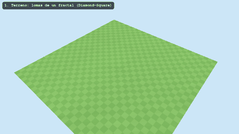
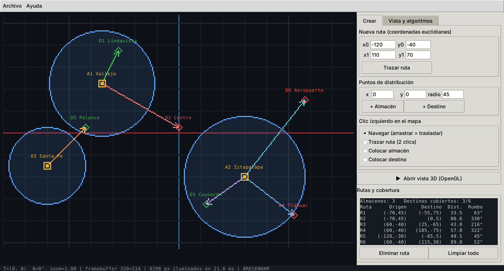
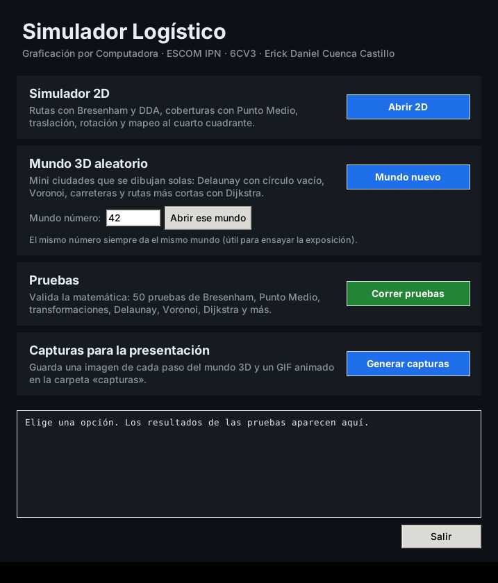
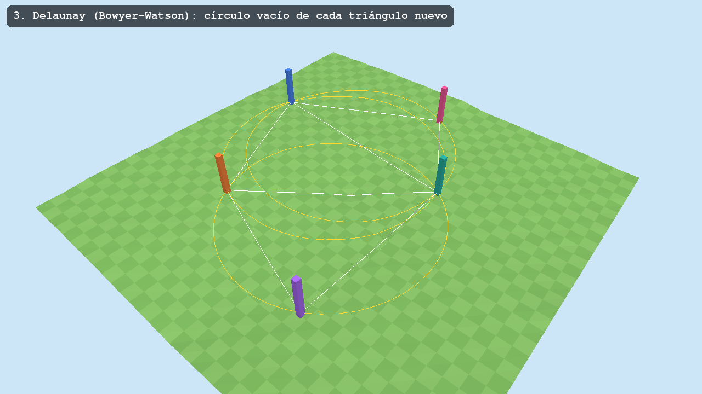
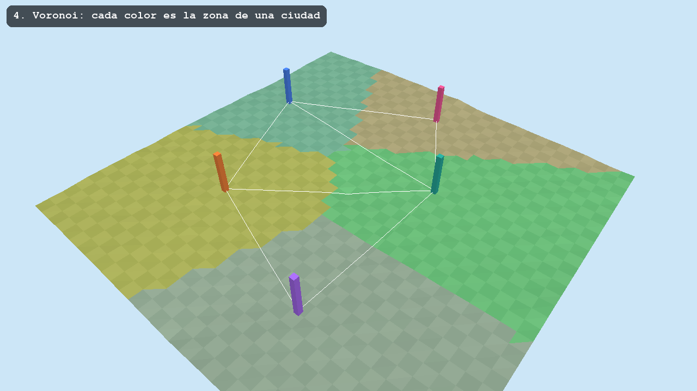
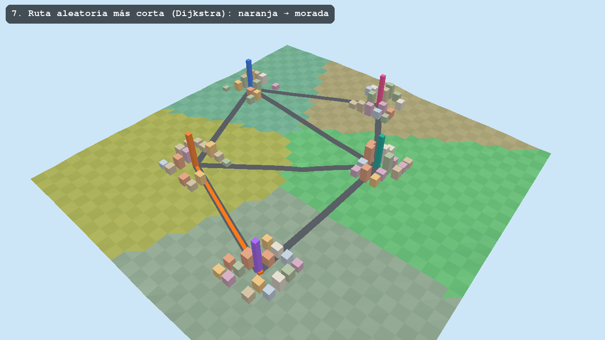
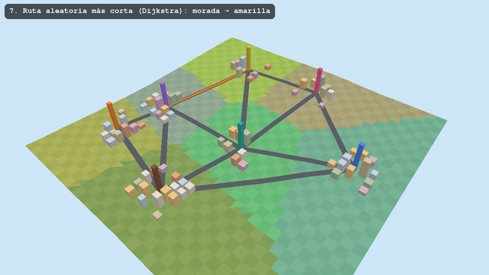
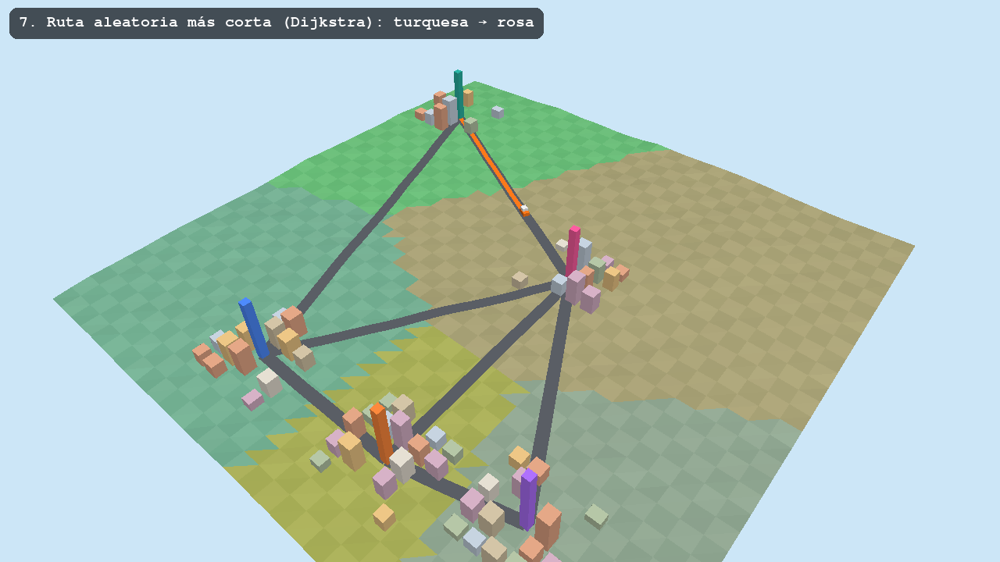
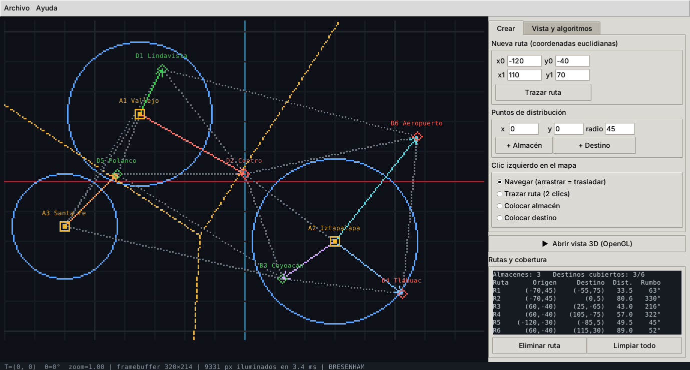

# Simulador Logístico Interactivo 2D / 3D
### Trazado de Rutas de Transporte y Áreas de Cobertura

**Graficación por Computadora** · ESCOM – IPN · Grupo 6CV3
**Autor:** Erick Daniel Cuenca Castillo



El proyecto tiene dos vistas:

- **Vista 2D (Tkinter):** el mapa logístico se dibuja **píxel por píxel** con algoritmos propios:
  Bresenham, DDA, Punto Medio, traslación, rotación y mapeo al cuarto cuadrante.
- **Vista 3D (OpenGL): un mundo pequeño y aleatorio que se dibuja solo.** Cada vez salen mini
  ciudades nuevas, hechas con figuras básicas (cajas), y el mundo se construye paso a paso:
  1. aparece el terreno (lomas suaves de un fractal Diamond–Square);
  2. aparecen las ciudades, cada una con su torre de color;
  3. **Delaunay con Bowyer–Watson**, ciudad por ciudad, mostrando el **círculo vacío** de cada triángulo nuevo;
  4. **Voronoi**: el terreno se pinta con el color de la ciudad más cercana;
  5. las aristas de Delaunay se vuelven **carreteras**;
  6. crecen los edificios de cada mini ciudad;
  7. **rutas aleatorias**: **Dijkstra** calcula el camino más corto y un auto lo recorre.



## Conceptos de la materia y dónde están

| Concepto | Uso en el simulador | Archivo |
|---|---|---|
| Bresenham (solo enteros) | Rutas, rejilla, flechas, Delaunay y Voronoi en 2D | `src/rasterizacion.py` |
| DDA (flotante) | Algoritmo alternativo para comparar | `src/rasterizacion.py` |
| Punto Medio (circunferencias) | Radios de cobertura | `src/rasterizacion.py` |
| Traslación, rotación, mapeo al cuarto cuadrante | Navegación 2D | `src/transformaciones.py` |
| Triangulación de Delaunay (Bowyer–Watson) | Red de carreteras entre ciudades | `src/geometria.py` |
| Círculo vacío (prueba del determinante) | Animación paso a paso de Bowyer–Watson | `src/geometria.py`, `src/mundo3d.py` |
| Diagrama de Voronoi | Zona de cada ciudad / almacén | `src/geometria.py` |
| Recorte de Liang–Barsky | Recortar aristas de Voronoi a la ventana 2D | `src/geometria.py` |
| Dijkstra | Ruta más corta entre dos ciudades al azar | `src/mundo3d.py` |
| Fractal Diamond–Square | Lomas del terreno 3D | `src/fractales.py` |
| Matrices 4×4: modelo, vista (lookAt), perspectiva | Cámara y objetos 3D | `src/matrices3d.py` |
| Iluminación de Lambert (una sola luz) | Colores planos | `src/vista3d.py` (GLSL) |

## Requisitos e instalación
- Python 3.9 o superior.
- Vista 2D: nada más (Tkinter viene con Python; en Linux `sudo apt install python3-tk`).
- Vista 3D: una tarjeta o chip gráfico con **OpenGL 3.3** y:
```bash
pip install -r requirements.txt
```

## Ejecutar
**La forma fácil:** doble clic en **`Abrir simulador.bat`** (Windows) o `python main.py`.
Se abre un menú con botones para todo:



| Botón del menú | Qué hace |
|---|---|
| Abrir 2D | El simulador 2D del protocolo |
| Mundo nuevo | Un mundo 3D aleatorio que se dibuja solo |
| Abrir ese mundo | El mundo 3D con el número que escribas (siempre sale igual) |
| Correr pruebas | Las 50 pruebas; el resultado aparece en el mismo menú |
| Generar capturas | Imágenes de cada paso y un GIF en la carpeta `capturas` |
| Instalar dependencias 3D | Solo aparece si falta numpy, moderngl o pygame-ce |

También se puede ejecutar cada parte directo desde la terminal:
```bash
python main.py                       # menú principal
python main.py --2d                  # vista 2D
python main.py --3d                  # un mundo 3D aleatorio que se dibuja solo
python main.py --3d 1234             # el mundo número 1234 (siempre sale igual, útil para exponer)
python main.py --capturas carpeta    # imágenes de cada paso y un GIF de la animación
```

## Controles de la vista 3D
| Acción | Control |
|---|---|
| Otro mundo aleatorio | `Espacio` |
| Mundos automáticos (uno nuevo tras 6 rutas) | `A` (activado al inicio) |
| Girar la cámara / acercar | Arrastrar con el ratón / rueda |
| Captura · salir | `P` · `Esc` |

Los controles de la vista 2D están en *Ayuda → Controles*.

## Pruebas (validación matemática)
```bash
python -m unittest -v
```
50 pruebas. Entre ellas: Bresenham con error ≤ ½ píxel; Punto Medio con simetría de 8
octantes; isomorfismo mundo → pantalla → mundo; Delaunay con la propiedad del círculo vacío,
la fórmula de Euler y el área de la envolvente convexa; Voronoi con aristas equidistantes a
los dos sitios más cercanos; Liang–Barsky; Diamond–Square; matrices de perspectiva y lookAt;
y el mundo aleatorio: misma semilla = mismo mundo, carreteras = aristas de Delaunay, y
**Dijkstra comparado contra probar todos los caminos posibles**. También corren solas en
GitHub Actions en cada `push`.

## Generar el ejecutable
```bash
pip install -r requirements.txt
build_windows.bat        # Windows → dist\SimuladorLogistico.exe
./build.sh               # Linux / macOS
```

## Solución de problemas
| Síntoma | Solución |
|---|---|
| `No module named 'tkinter'` | Linux: `sudo apt install python3-tk`. Windows: reinstala Python marcando *tcl/tk and IDLE* |
| `La vista 3D necesita numpy, moderngl y pygame-ce` | `pip install -r requirements.txt` |
| `Failed to build 'pygame'` al instalar | Tu Python es muy nuevo para pygame: instala `pygame-ce` (`pip install pygame-ce`), que se usa igual |
| Error de OpenGL / versión 3.3 | Actualiza el controlador de video; en laptops con dos GPU, abre Python con la tarjeta dedicada |
| `'python' no se reconoce…` | Usa `py main.py` o reinstala marcando *Add python.exe to PATH* |
| Animación 2D lenta | Sube el *Tamaño píxel* a 3 o más |

## Estructura
```
simulador_logistico/
├── Abrir simulador.bat      # doble clic para abrir el menú (Windows)
├── main.py                  # punto de entrada: menú, --2d, --3d, --capturas
├── src/
│   ├── rasterizacion.py     # DDA, Bresenham, Punto Medio, relleno
│   ├── transformaciones.py  # 2D: traslación, rotación, cámara y mapeo
│   ├── framebuffer.py       # cuadrícula de píxeles lógicos + recorte
│   ├── modelo.py            # Almacén, Destino, Ruta, Escenario (JSON)
│   ├── render.py            # pipeline 2D: mundo → píxeles
│   ├── menu.py              # menú principal con botones
│   ├── app.py               # interfaz Tkinter de la vista 2D
│   ├── geometria.py         # Delaunay, Voronoi, Liang–Barsky
│   ├── fractales.py         # Diamond–Square
│   ├── matrices3d.py        # matrices 4×4 propias
│   ├── mundo3d.py           # mundo aleatorio: ciudades, carreteras, Dijkstra, animación de Delaunay
│   └── vista3d.py           # ventana OpenGL y animación por pasos
├── escenarios/demo_cdmx.json
├── tests/                   # 50 pruebas
├── docs/img/                # capturas y GIF
├── .github/workflows/       # pruebas automáticas en GitHub
└── build_windows.bat · build.sh
```

## Capturas
| 3. Delaunay y círculo vacío | 4. Voronoi | 7. Ruta de Dijkstra |
|---|---|---|
|  |  |  |

| Otro mundo | Otro mundo más | Delaunay + Voronoi en 2D |
|---|---|---|
|  |  |  |

## Referencias
- Hearn, D., Baker, M. P., & Carithers, W. (2014). *Computer Graphics with OpenGL* (4th ed.). Pearson.
- Hughes, J. F., et al. (2014). *Computer Graphics: Principles and Practice* (3rd ed.). Addison-Wesley.
- Shirley, P., & Marschner, S. (2021). *Fundamentals of Computer Graphics* (5th ed.). CRC Press.
- de Berg, M., Cheong, O., van Kreveld, M., & Overmars, M. (2008). *Computational Geometry: Algorithms and Applications* (3rd ed.). Springer.
- Fournier, A., Fussell, D., & Carpenter, L. (1982). Computer rendering of stochastic models. *Communications of the ACM, 25*(6), 371–384.
- Cormen, T. H., Leiserson, C. E., Rivest, R. L., & Stein, C. (2009). *Introduction to Algorithms* (3rd ed.). MIT Press.
